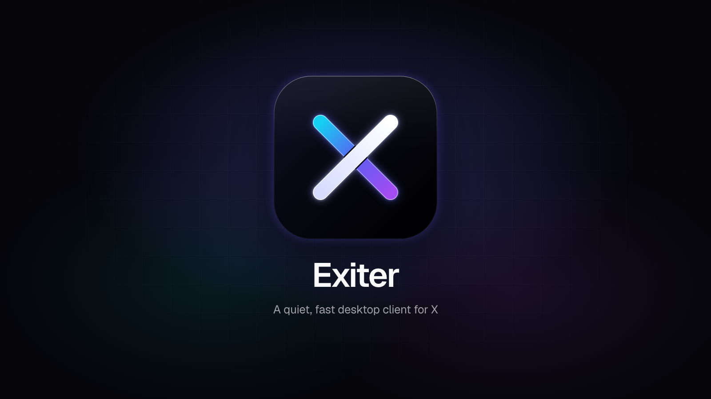
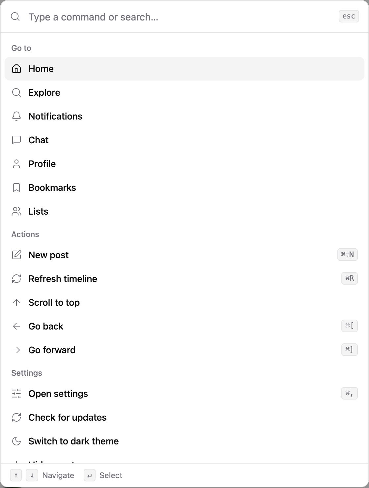
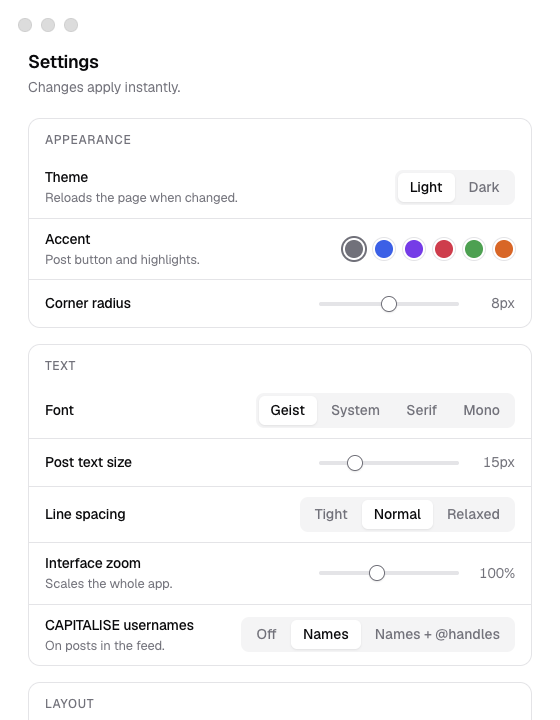

<p align="center">
  
</p>

# Exiter

**A quiet, fast desktop app for X.** Exiter wraps x.com in its own window and gives it a clean, minimal, [shadcn](https://ui.shadcn.com)-inspired look, a command palette, real keyboard navigation and a settings window to switch off the clutter. You sign in to X as usual; there is no API and no account on Exiter's side.

> **Early release (v0.1).** It works and is used daily, but expect rough edges. Please open an issue if something looks wrong.

## Why this exists

The official native X (Twitter) app for Mac is no longer developed. [Reporting from 9to5Mac, iMore and AlternativeTo](#sources) says it was left unmaintained after the 2022 acquisition and removed from the Mac App Store in August 2024, with Mac users pointed to the iPad app (which only runs on Apple Silicon Macs) or the website. That leaves a browser tab as the main way to use X on a desktop.

Exiter is a small, dedicated app instead of a tab: its own window and Dock icon, a menu bar icon, a global shortcut, and a UI that stays out of the way.

## Download

Get the latest build from the [**Releases page**](https://github.com/kylebolton/Exiter/releases/latest).

| Platform | File | Notes |
| --- | --- | --- |
| macOS (Apple Silicon + Intel) | `Exiter-<version>-mac-universal.dmg` | Signed and notarized by Apple. Open the disk image and drag Exiter to Applications. |
| Windows 10/11 (x64) | `Exiter-<version>-win-x64.exe` | Not code-signed, so SmartScreen will warn: choose **More info → Run anyway**. |
| Linux (x64) | `Exiter-<version>-linux-x86_64.AppImage` or `.deb` | AppImage: `chmod +x` and run. |

> Windows and Linux builds are provided as-is. They are built from the same code but have not been tested on those systems yet.

## Features

- **A calmer interface.** A zinc-neutral design system with light and dark themes, Geist type, thin line icons, hairline-divided posts and an icon rail that adapts to the window width.
- **Command palette (Cmd/Ctrl+K).** Jump to any page, start a post, refresh the timeline, flip the theme, or search X and open an `@name`, all from the keyboard.
- **Refresh that works.** Cmd/Ctrl+R (or the refresh button) loads new posts; Cmd/Ctrl+Shift+R reloads the page. If your connection drops, Exiter shows an offline screen and reconnects by itself.
- **Make it yours.** Settings cover theme, accent colour, font, text size, line spacing, interface zoom, feed width, density, media size, and which sidebar items appear. There is an option to CAPITALISE usernames.
- **Hide what you don't want.** Promoted posts, the right-hand column, suggestions, the floating chat buttons, the X logo and engagement counts can each be switched off.
- **Desktop touches.** Menu bar icon, global shortcuts (**Cmd/Ctrl+Shift+X** show or hide, **Cmd/Ctrl+Shift+N** new post), close-to-tray on macOS, launch at login.
- **Automatic updates.** See [Updates](#updates).

<p align="center">
  
  &nbsp;&nbsp;
  
</p>

## Updates

- **macOS** uses [Sparkle](https://sparkle-project.org) (through [`electron-sparkle`](https://github.com/biw/electron-sparkle)). Updates are checked automatically and every update is signed with an EdDSA key that the app verifies before installing. Use **Exiter → Check for Updates…** at any time.
- **Windows and Linux (AppImage)** use [`electron-updater`](https://www.electron.build/auto-update) against the same GitHub releases. The `.deb` package does not update itself.

Updates are only checked in installed builds, never when running from source.

## Privacy

Exiter is the website in a window. It has no API access, no analytics, no telemetry and no server of its own. Your login stays in the app's own storage on your computer, and Exiter only loads x.com (links to other sites open in your default browser). The only other request it makes is to GitHub, to look for updates.

## Disclaimer

Exiter is an independent, unofficial project. It is **not affiliated with, endorsed by, or sponsored by X Corp.** "X" and "Twitter" are trademarks of their owner. Exiter changes only how the website looks and behaves on your own screen; you remain bound by X's terms of service. Use it at your own risk.

## Build from source

Requires Node 20+.

```sh
git clone https://github.com/kylebolton/Exiter.git
cd Exiter
npm install
npm start          # run the app
npm run dev        # run with remote debugging on :9222
npm run fonts      # regenerate the embedded Geist font CSS
npm run icons      # regenerate icons from assets/*.svg
npm run dist       # unsigned installers for your OS, written to dist/
```

### Releasing

Maintainers only. A release needs a Developer ID certificate, an App Store Connect API key for notarization, and the Sparkle signing key (kept in the login keychain, never in the repo).

```sh
scripts/release-mac.sh                 # build, sign, notarize and staple the macOS app and dmg
scripts/build-other.sh                 # Windows and Linux installers
scripts/publish-release.sh notes.md    # appcast, checksums, GitHub release
```

## Credits

[Geist](https://vercel.com/font) (SIL OFL 1.1), [Lucide](https://lucide.dev) icons (ISC), [Sparkle](https://sparkle-project.org) (MIT), [Electron](https://www.electronjs.org) (MIT). See [THIRD_PARTY.md](THIRD_PARTY.md).

## Sources

- 9to5Mac: [X (Twitter) Mac app](https://9to5mac.com/2024/08/03/twitter-x-mac-app/)
- iMore: [The Mac app for Twitter appears gone for good, after being removed from the App Store](https://www.imore.com/apps/mac-apps/the-mac-app-for-twitter-appears-gone-for-good-after-being-removed-from-the-app-store)
- AlternativeTo: [The old X/Twitter native Mac app has been discontinued and replaced by the iPad version](https://alternativeto.net/news/2024/8/the-old-x-twitter-native-mac-app-has-been-discontinued-and-replaced-by-the-ipad-version/)

## License

[MIT](LICENSE) © 2026 Kyle Bolton
